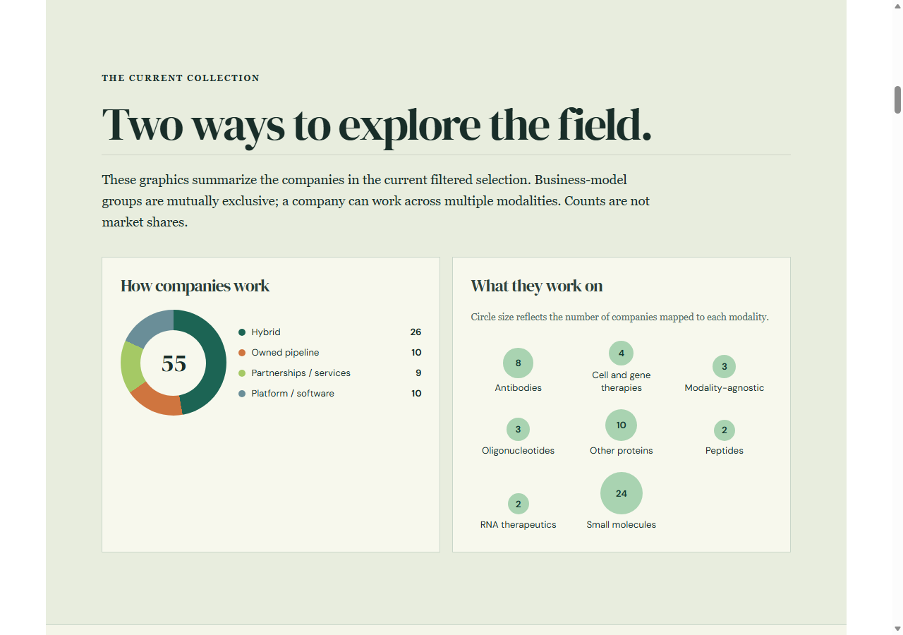
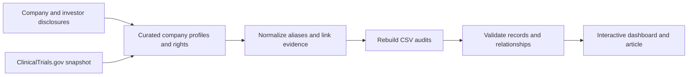

# AI Biotech Landscape

**Question:** Where do AI-focused biotech companies apply their technologies across drug discovery and development, and what do public disclosures establish about their pipelines and ownership?

[Explore the live dashboard](https://ichunglo.github.io/posts/2026-11-10-ai-biotech-landscape/) · [Results](results/RESULTS.md) · [Methods](docs/METHODS.md) · [Dataset guide](docs/DATA_DICTIONARY.md)

## Snapshot

This curated US and Europe-focused landscape contains **55 companies**, **81 asset records**, and **90 ClinicalTrials.gov study records**, with source-linked company, pipeline and ownership audits. The research snapshot is November 11–12, 2026. Counts describe the reviewed collection, not the AI biotech market; the 81 rows are asset–indication records and can include the same asset more than once.

Companies are mapped across target discovery, molecular design, preclinical prediction, and clinical development; and by application, modality, geography, and business model. Oligonucleotides are included. Physics-based simulation is separately identified because it is not necessarily AI.

| Company business model | Companies |
|---|---:|
| Hybrid | 26 |
| Owned pipeline | 10 |
| Platform / software | 10 |
| Partnerships / services | 9 |



These are editorial classifications, not measures of revenue or market share. The selected companies span both therapeutic developers and specialist platform providers. A missing capability tag means it was not mapped in this collection.

## Workflow



Primary company and regulatory disclosures were used where available. The study file includes historical, completed, terminated, and selected partner-sponsored studies. An individual study phase and sponsor do not establish current program status, clinical success, or asset ownership. Historical investors and beneficial-ownership filings are dated, and do not establish today's cap table.

## Run locally

Requirements: **Node.js 18+**, **Python 3.10+**, and [Quarto](https://quarto.org/) for rendering the dashboard. From the repository root:

```bash
node ai-biotech-landscape/scripts/build_audits.js
python -m unittest discover -s ai-biotech-landscape/tests -v
quarto render ai-biotech-landscape
quarto preview ai-biotech-landscape
```

`build_audits.js` regenerates four CSV summaries from the included curated JavaScript records and validates cross-references. The original registry snapshot and sponsor-search log are inputs: the command **does not query ClinicalTrials.gov, refresh sources, or reproduce the original research and manual judgments**. A new research refresh requires separately retrieving, reviewing, dating and updating those inputs; do not change the snapshot date without doing that work. Rendering creates `ai-biotech-landscape/_site/` locally.

## Repository contents

- [`dashboard/`](dashboard/): source article, interactive dashboard, original data scripts and source-linked CSVs.
- [`dashboard/company-audit.csv`](dashboard/company-audit.csv): company-level profile, portfolio, rights and evidence links.
- [`dashboard/asset-audit.csv`](dashboard/asset-audit.csv): selected named asset–indication, phase and rights records.
- [`dashboard/ownership-audit.csv`](dashboard/ownership-audit.csv): dated investor and legal-entity disclosures.
- [`dashboard/pipeline-coverage.csv`](dashboard/pipeline-coverage.csv): one evidence-limited portfolio summary per company.
- [`dashboard/trial-audit.csv`](dashboard/trial-audit.csv) and [`dashboard/sponsor-search-audit.csv`](dashboard/sponsor-search-audit.csv): study snapshot and the documented sponsor queries.
- [`scripts/build_audits.js`](scripts/build_audits.js): regenerate four derived audits.
- [`tests/`](tests/): offline snapshot and relationship checks.
- [`results/RESULTS.md`](results/RESULTS.md) and [`docs/`](docs/): findings, methods and column definitions.

The project is a curated, non-exhaustive historical snapshot. Private ownership, program details and contracts may be undisclosed; missing records are not evidence of absence. Company descriptions and claimed capabilities are not necessarily independently validated. The work is for research and is not medical or investment advice.

Code follows the repository's MIT license. Article text and generated cover artwork remain the author's copyrighted content; source material and third-party data remain subject to their respective rights and terms. Source links and access dates are included to support attribution and review.
