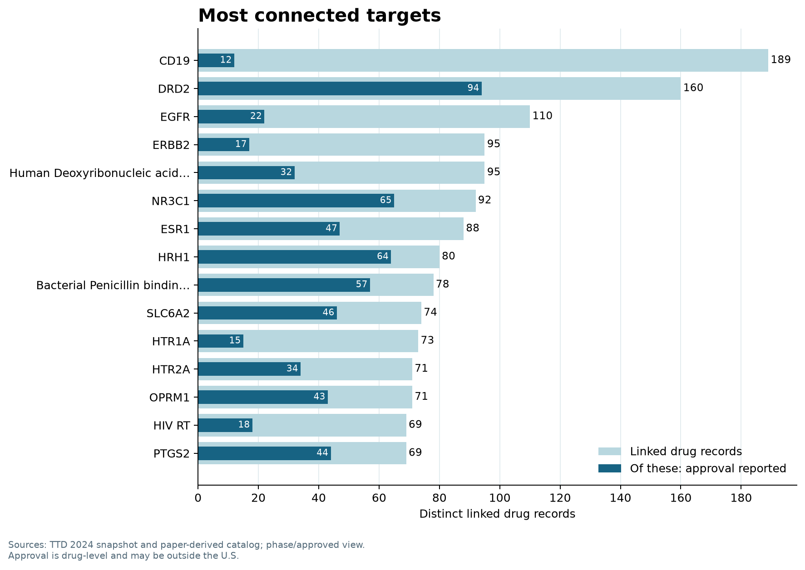
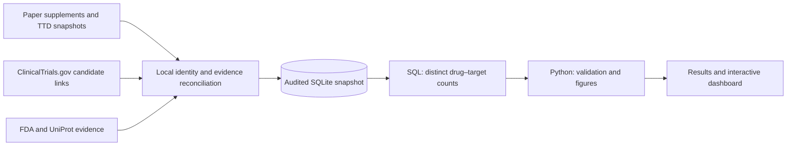
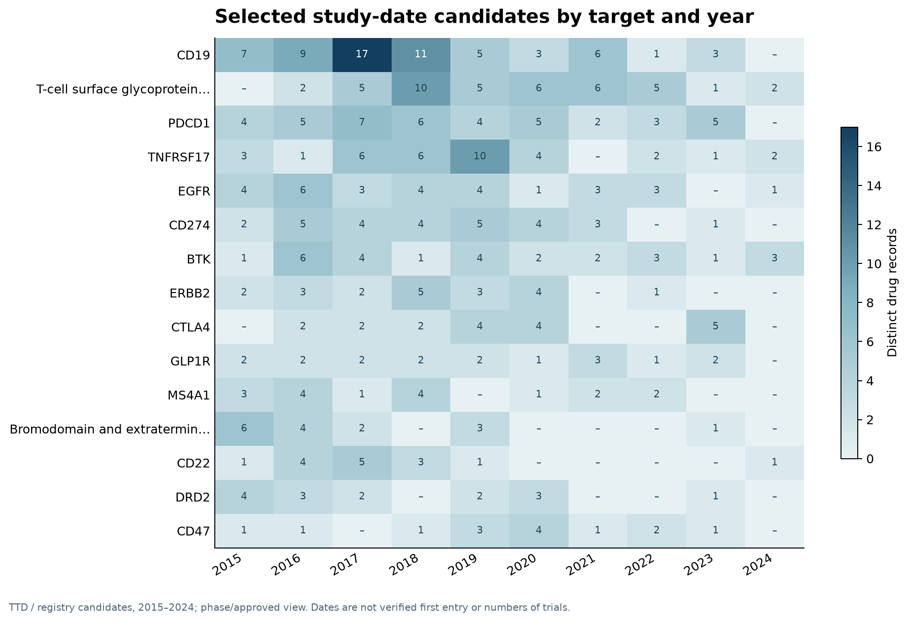

# Drug–Target Landscape: Data Analysis

**Research question:** Which targets are linked to the most drug records with a reported clinical phase or approval, and how does the evidence vary across target types, drug categories, and time?

[**Explore the interactive dashboard**](https://ichunglo.github.io/posts/2026-10-02-drug-target-landscape/) · [Results](docs/RESULTS.md) · [Methods](docs/METHODS.md) · [Data sources](docs/DATA_SOURCES.md) · [SQL](sql/target_rankings.sql) · [Python](src/analyze.py)

## Project at a glance

The audited local snapshot contains **27,932 drug records, 3,156 target records, and 40,915 drug–target relationships**. The default analysis uses the subset with a source-reported clinical phase or a drug-level approval: **10,779 distinct drug records, 2,428 targets, and 14,523 relationships**. Some target records represent families, complexes, or non-protein targets; some generic drug names remain unresolved.

In this selected view, **CD19** is linked to 189 drug records, of which 12 have a source-reported approval. **DRD2** is linked to 160, including 94 with a reported approval. These are descriptions of the available records, not a measure of target quality or a probability of success. Approval is reported for the drug and may concern another indication or target.



## Objective

Build a research-ready overview of drug–target relationships that lets a drug-discovery analyst identify well-represented targets, examine source-supported development status, and decide which associations warrant further review. The workflow records uncertainty rather than interpreting missing approval as failure.

## Workflow and data model



The SQLite snapshot stores drugs, targets, relationships, source evidence, study candidates, and approval records separately. The flat analysis view joins them at one row per drug–target pair. A drug can appear under multiple targets. See the [data dictionary](docs/DATA_DICTIONARY.md) and [source details](docs/DATA_SOURCES.md).

## Analysis and visualizations

1. **Target ranking:** Count distinct linked drug records and overlay the subset with a source-reported drug approval.
2. **Drug categories:** Compare small molecules, biologics, other, and unknown classifications across highly connected targets.
3. **2015–2024 candidate evidence:** Compare selected study-date proxies by target and year. A cell counts linked drugs, not trials; dates are not verified first clinical entry.



[View all figures and findings →](docs/RESULTS.md)

## Run the reproducible demo

The repository includes a small **fictional** database generator. This demonstrates the analysis without redistributing the source datasets. Requires Python 3.10+.

```bash
python -m venv .venv
# Windows PowerShell: .venv\Scripts\Activate.ps1
# macOS/Linux: source .venv/bin/activate
python -m pip install -r requirements.txt
python drug-target-landscape/examples/create_demo.py --out demo-data/demo.sqlite
python drug-target-landscape/src/analyze.py --db demo-data/demo.sqlite --out analysis-output/demo
python -m unittest discover -s drug-target-landscape/tests -v
```

Commands are run from the repository root. The outputs include a target ranking CSV, a manifest with input SHA-256, and PNG/SVG figures. Results from the demo are invented and must not be treated as research findings.

## Run against the audited snapshot

The real SQLite snapshot is **not included in this repository**. Given the same local v6 database, run:

```bash
python drug-target-landscape/src/analyze.py --db /path/to/unified-drug-targets.sqlite --out analysis-output/actual
```

Use `--scope broad` to include all retained source relationships. That broader view includes unphased investigative substances, research compounds, and radioligands; it is not a count of clinical candidates. The [reproducibility notes](docs/METHODS.md) explain the exact filters and source versions. Rebuilding the audited SQLite snapshot itself requires upstream local inputs and curation steps not packaged here.

## Important limitations

- Approval status combines source-reported approvals from the paper and TTD; it is **not FDA-only**. FDA evidence coverage is incomplete.
- Trial links and dates include unverified candidates. A date proxy is not necessarily a drug’s first clinical study.
- Missing approval is not proof of failure or absence of approval. The sources are not a complete matched cohort, so this project does not calculate a clinical development success rate.
- Target–drug and drug–disease associations do not by themselves establish a target–drug–disease mechanism.
- This analysis is for research and portfolio demonstration, not medical advice.

## Files

```text
drug-target-landscape/
├── README.md               Project overview and quickstart
├── src/analyze.py          Read-only analysis and figure generation
├── sql/target_rankings.sql Distinct drug counts and source-reported approvals
├── examples/               Fictional demo database generator
├── tests/                  Counting and deduplication tests
├── figures/                Snapshot visualizations
├── results/                Snapshot summary and input hash
└── docs/                   Results, methods, sources, and data dictionary
```

Code is licensed under the repository’s [MIT license](../LICENSE). Third-party source data have their own terms. TTD redistribution terms were not independently confirmed; the underlying source snapshots and SQLite database are not included here. See [data sources](docs/DATA_SOURCES.md).
