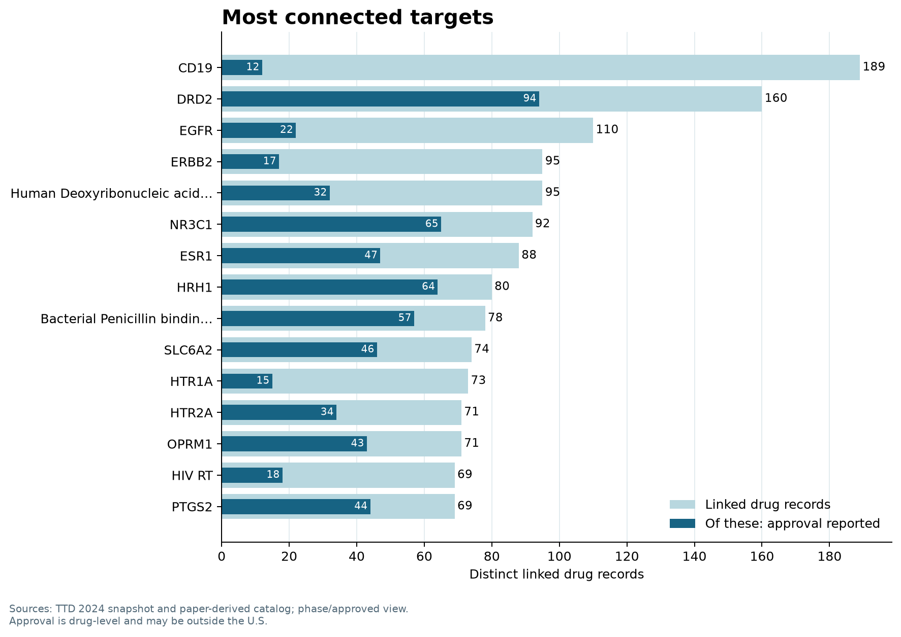
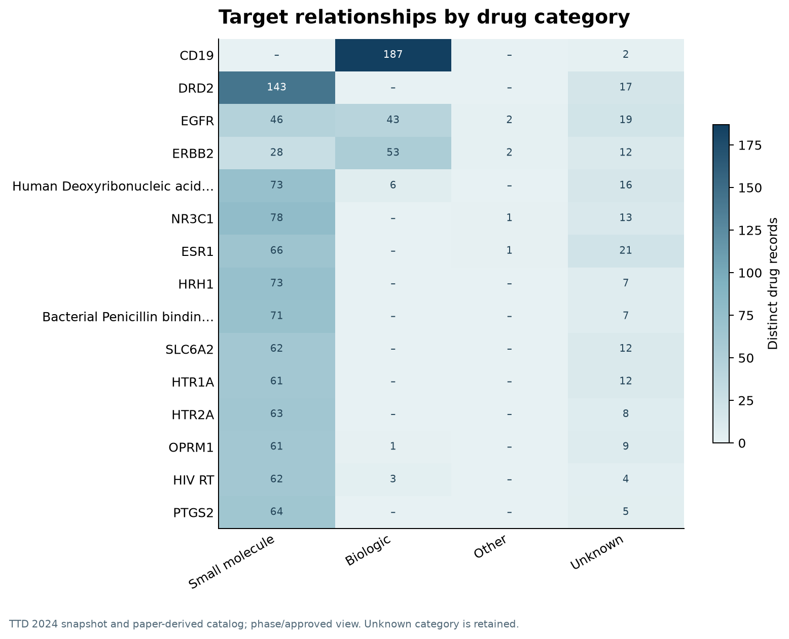
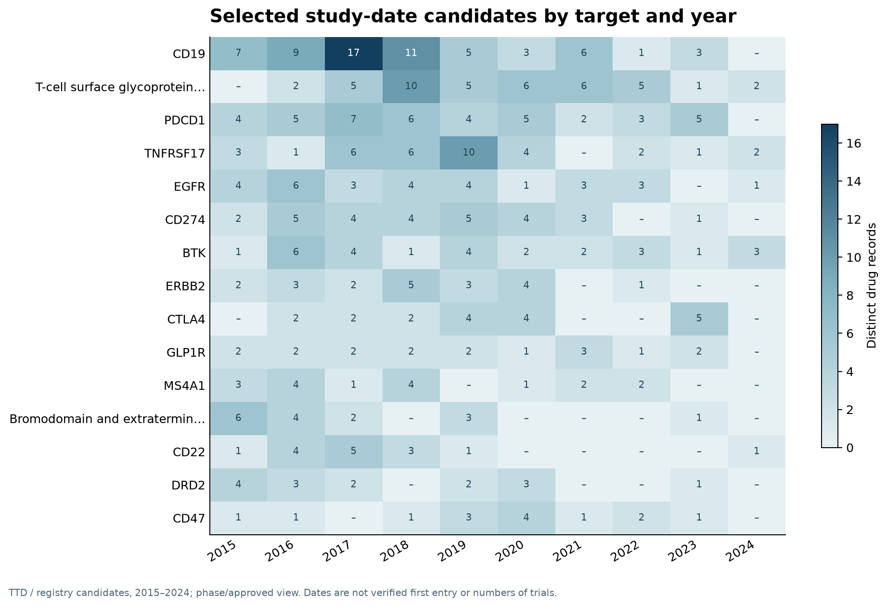
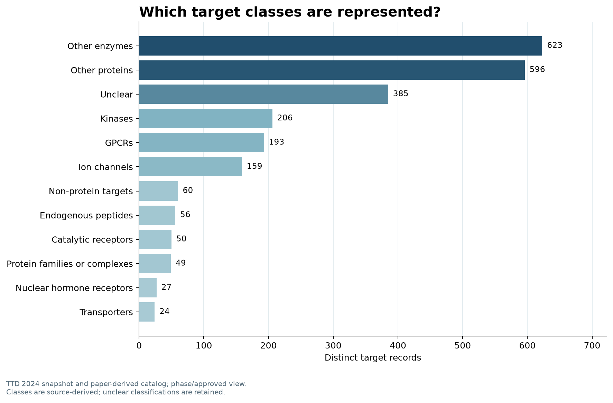
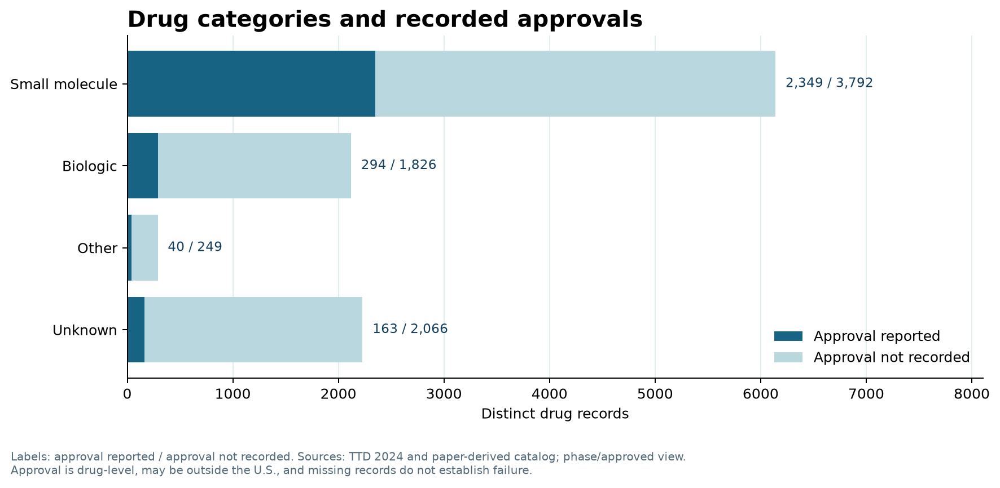
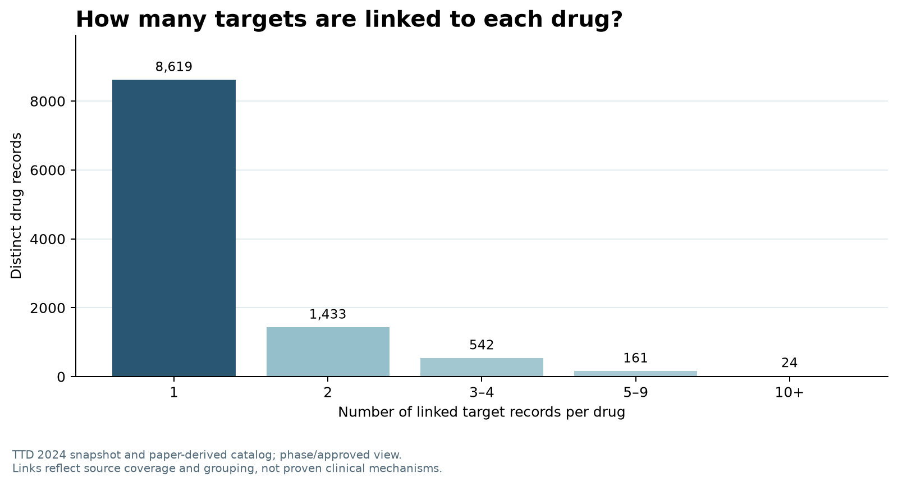
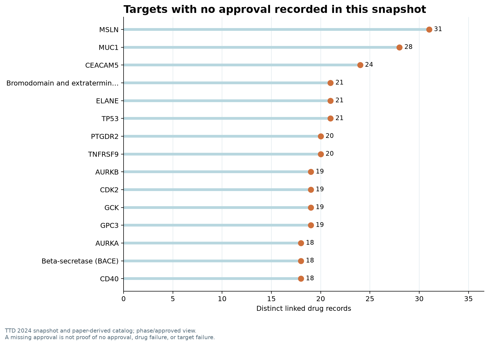

# Results: audited snapshot

The following figures use the **reported phase or approved drug** view of the v6 snapshot. They describe the source data available to this project, not all drugs or studies worldwide. The exact input hash is in [the manifest](../results/analysis-manifest.json).

## Which targets have the most linked drug records?

| Target | Distinct linked drugs | Of those, approval reported |
|---|---:|---:|
| CD19 | 189 | 12 |
| DRD2 | 160 | 94 |
| EGFR | 110 | 22 |
| ERBB2 | 95 | 17 |
| Human DNA | 95 | 32 |

The approved count is a **drug-level** source claim and may be outside the U.S.; it does not establish that each target is responsible for an approved use. Human DNA is a non-protein target. Counts for generic products can include unresolved identities.

## Which drug categories appear across the top targets?

The heatmap compares distinct linked drug records by source-derived category. It retains `Unknown`, and a drug linked to different targets can appear in more than one row.

## When do selected study-date candidates appear?

Among the targets in this view, CD19 has **62 distinct linked drug records** with at least one selected study-date candidate in 2015–2024; PDCD1 has **41**. These are candidate drug records, not trial counts or verified first entries. The same drug can occur in more than one year, so annual cells should not be summed to count distinct drugs over the full period.

## Which target classes are represented?

The selected view contains **623 target records classified as other enzymes**, 206 as kinases, 193 as GPCRs, and 159 as ion channels. A further **385 records have an unclear class**. These are target records, not numbers of drugs; the broad “other” groups reflect the available classification and should not be interpreted as a single protein family.

## What kinds of drugs are represented, and which have a recorded approval?

The selected view contains **6,141 small-molecule records** and **2,120 biologic records**. Sources report approval for 2,349 and 294 of those records, respectively; the remainder have no approval recorded in this snapshot. Another **2,229 drug records have an unknown category**. Each drug is counted once, even if linked to multiple targets. Counts depend on classification and source coverage; comparing the portions does not yield clinical success rates.

## How many targets are linked to each drug?

In this view, **8,619 drug records have one retained target link** and **2,160 have two or more**. This measures the connections in the database, not the number of targets each drug is known to bind in reality. Differences in source coverage, identity matching, target grouping, and the view's selection rules affect the counts.

## Which well-connected targets have no approval recorded?

Within this snapshot and selected view, **MSLN** has 31 linked drug records, **MUC1** has 28, and **CEACAM5** has 24; none of the linked records has a source-reported approval in this dataset. This is a **priority list for checking sources**, not proof that these targets or drugs lack approval, nor that their development failed. Approval is a drug-level field and source coverage is incomplete.

## How can the results guide follow-up?

An analyst can use the ranking to select target–drug records for **source verification**, beginning with targets that have many linked records or few recorded approvals. For example, the snapshot has 31 linked MSLN records and no approval recorded among them. That is a review queue, **not evidence that the target is unapproved or that its development failed**. The interactive dashboard exposes the underlying records and source links.

The dataset is assembled from different sources and is not a complete matched cohort. It cannot estimate clinical success probabilities or support treatment decisions. See [methods](METHODS.md) and [data sources](DATA_SOURCES.md).
